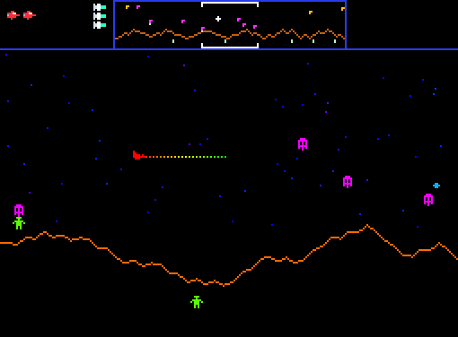

# Defender (Rust / WebAssembly)

A retro arcade shooter written in **Rust** and compiled to **WebAssembly** with zero external crate dependencies, reverse-engineered from Keith Clark's 2015 JS1K entry [**Defender: 1024**](https://keithclark.co.uk/articles/js1k-2015-defender/) (read Keith Clark's [write-up on creating the original 1K game](https://keithclark.co.uk/articles/js1k-2015-defender/)).



## Gameplay

Save the humans on the surface from alien abduction! Pilot your ship across a 1024-pixel wrapping planetscape and destroy incoming **Landers** before they grab a **Human** and carry them to the top of the screen—where they transform into fast, aggressive **Mutants** programmed to hunt you down.

### Controls

| Key | Action |
| --- | --- |
| `←` / `→` (or `A` / `D`) | Thrust left / right |
| `↑` / `↓` (or `W` / `S`) | Climb / dive |
| `Space` | Fire laser |
| `Z` | Smart Bomb (destroys all on-screen enemies) |
| `H` | Hyperspace (random teleport across the planet) |
| `P` (or **PAUSE** button) | Pause / resume game |
| `R` (or `Enter` on Game Over) | Restart game |

### Lives, Abilities & Scoring

- **Lives:** You start with **3 lives** (also shown as miniature red Defender ship icons in the upper-left HUD). Losing a life respawns your ship with a brief warp-in animation; the game ends when all 3 lives are used up.
- **Smart Bomb (`Z`):** You start with **3 Smart Bombs** (displayed as stacked torpedo icons left of the radar scanner) and earn **+1 bonus bomb every 10,000 points**. Triggering a Smart Bomb flashes the playfield and destroys every on-screen Lander, Mutant, and enemy bullet—awarding full points and safely releasing any abducted humans.
- **Hyperspace (`H`):** Unlimited emergency jump that teleports your ship to a random position (`x` in `0..1024`, `y` in `12..132`), snaps the camera to the new location, and resets horizontal velocity—with no invulnerability, so landing near an enemy is genuinely risky.
- **Top-of-Screen Radar Scanner:** A classic 8:1 scale overview of the full 1024-pixel wrapping planet centered on your viewport, displaying white viewport brackets, the miniature mountain range, your ship (`+`), humans, Landers, and Mutants, flanked by reserve life ships and stacked Smart Bomb icons.

- **Lander destroyed:** +150 pts
- **Mutant destroyed:** +200 pts
- **Enemy bullet intercepted:** +50 pts

## Prerequisites

- [Rust](https://www.rust-lang.org/tools/install) with the `wasm32-unknown-unknown` target:
  ```sh
  rustup target add wasm32-unknown-unknown
  ```
- Python 3 (used by `make run` to serve the static web files)

## Build, Test, and Run

The included [`Makefile`](Makefile) provides targets for building, testing, and running the game locally:

```sh
# Compile the Rust game engine to web/defender.wasm
make build

# Run the Rust unit test suite
make test

# Build and start a local web server at http://localhost:8080
make run

# Remove build artifacts
make clean
```

You can override the HTTP port with `make run PORT=3000`.

## Project Structure

```text
.
├── Cargo.toml          # Rust crate configuration (zero external dependencies)
├── Makefile            # Build, test, run, and clean targets
├── docs/
│   └── screenshot.png  # In-game screenshot rendered by the WASM engine
├── src/
│   ├── game.rs         # Core simulation, physics, AI, pixel renderer, and unit tests
│   └── lib.rs          # C-ABI WebAssembly exports
└── web/
    ├── index.html      # Arcade cabinet HTML shell
    ├── style.css       # Retro dark UI styling
    └── main.js         # Minimal WASM loader, input handler, and Canvas2D blitter
```

## Reverse-Engineering Notes

All original mechanics from *Defender: 1024* are preserved in `src/game.rs`:

- **Wrapping World:** 1024-pixel horizontal coordinate space (`& 1023`) with shortest-path wrap-around delta calculations for AI targeting and laser hit detection.
- **Procedural Scenery:** Deterministic mountain range (`F += cos((d / 5) & -11)`) and 2x-parallax starfield derived from the terrain height.
- **Entities & Sprites:** 5 entity types (`Player`, `Human`, `Bullet`, `Lander`, `Mutant`) rendered from the original XOR-69 encoded 7×8 pixel bitmaps, complete with warp-in convergence (`w > 0`) and pixel-scatter explosions (`w < 0`).
- **Abduction Loop:** Landers select and descend onto ungrabbed humans, align 8px above them, and lift them skyward. Shooting the lander releases the human to fall safely back to the surface; if the human reaches the top (`y < 1`), they transform into a faster Mutant.
- **Direct WASM Framebuffer:** Both simulation and 510×376 RGBA pixel rendering (2x scaled logical 255×188 canvas: 28px top radar/HUD band + 160px playfield with HSL-to-RGB colors) run inside Rust/WASM, blitted directly onto `<canvas>` via `ImageData`.
